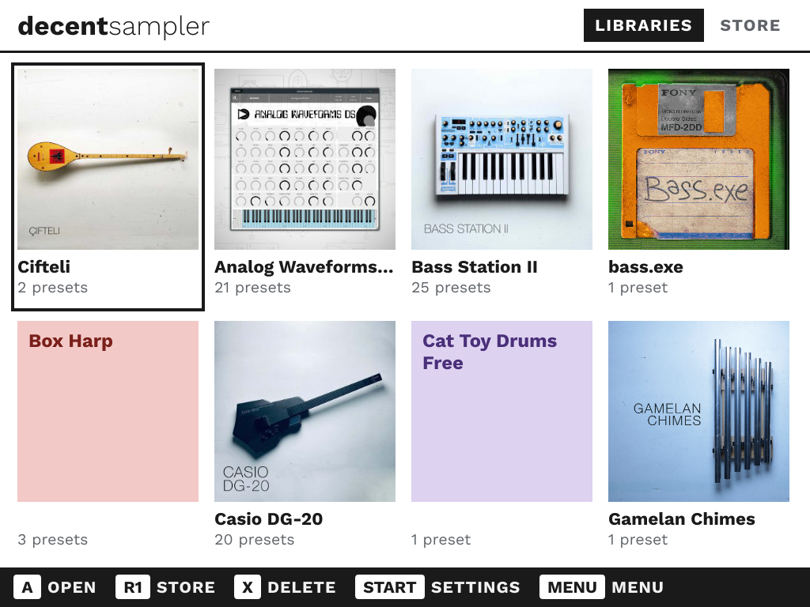
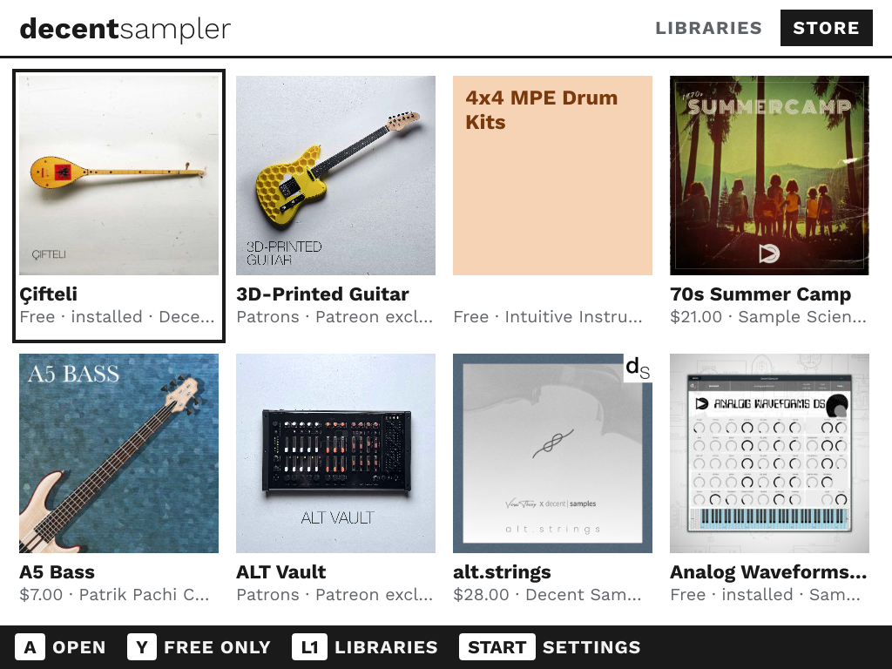
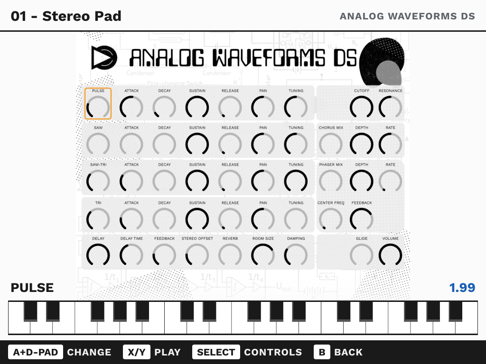
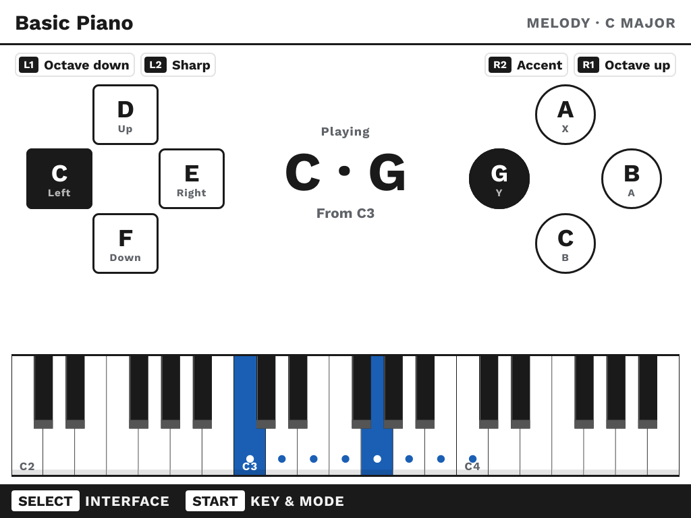
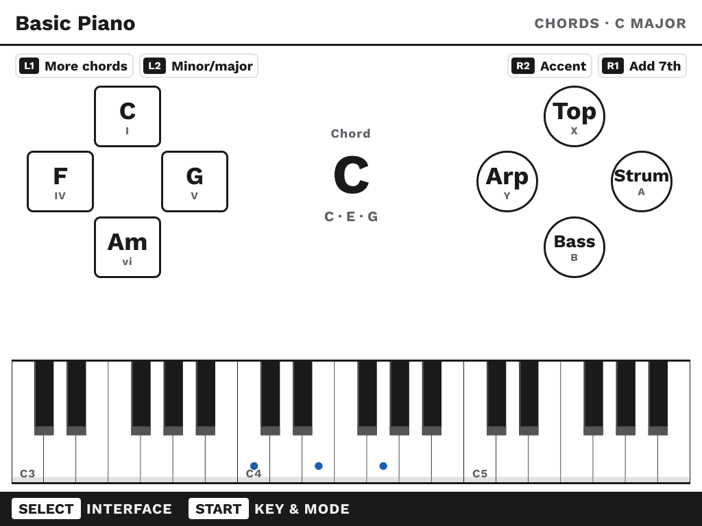
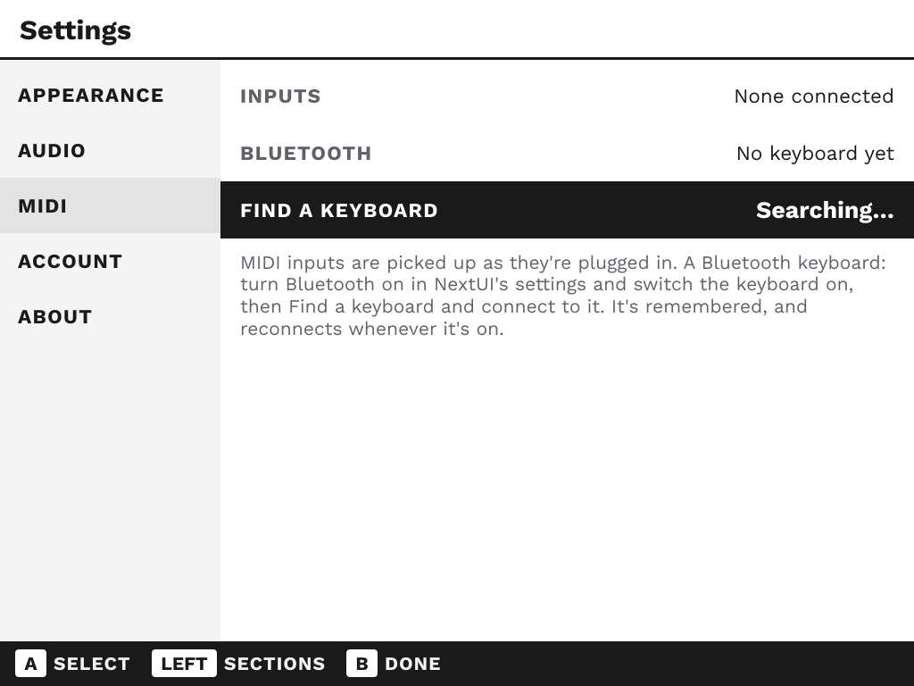

# Decent Sampler for TrimUI Brick

[Decent Sampler](https://www.decentsamples.com/product/decent-sampler-plugin/) is a free sample player. This is
it on the TrimUI Brick, as a NextUI pak: it plays Decent Sampler instruments from the Brick's buttons or a MIDI
keyboard, and has the Decent Samples store built in, so you can find and download libraries on the device itself.

**It's a beta.** Tell us what works and what doesn't at the
[Decent Samples bug tracker](https://www.decentsamples.com/bugtracker/).

## Installing

**On NextUI:** install or update Decent Sampler through the **Pak Store**.

**By hand:**

1. Download `DecentSampler.pak.zip` from the [releases page](https://github.com/DecentSamples/decent-sampler-pak/releases).
2. Make a folder called `Decent Sampler.pak` on your SD card under `Tools/tg5040/`, and unzip the zip into it.
3. Reinsert the card and open **Decent Sampler** from the Tools menu.

The same release is also on [decentsamples.com](https://www.decentsamples.com/product/decent-sampler-plugin/),
under "Other platforms and versions".

## Your libraries

Libraries live in `/mnt/SDCARD/DecentSampler/Libraries/`, outside the pak, so they survive updates and
reinstalls. There are two ways to get them there:

- **The store**: press **R1** on the library screen. Free libraries download straight away. To get the ones you
  own, sign in from **Settings › Account**: the Brick shows a code to scan with your phone.
- **By hand**: copy a library's folder (the one holding its `.dspreset` files) into `Libraries/`.

Paid libraries also need the Brick added to your account's devices, at
[decentsamples.com/store/devices](https://www.decentsamples.com/store/devices). After that they play without a
connection.

## Playing

Open a library, then a preset. It opens on the instrument's own interface, if it has one: A and the d-pad
change its controls, X and Y play a note. SELECT moves on to its controls as pages of knobs, then to playing it
from the buttons, then back to its interface.

- **Melody**: the d-pad and the face buttons play the notes of the key; L1 and R1 move down or up an octave.
- **Chords**: the d-pad plays the key's chords; the face buttons strum, arpeggiate, or add the bass or top note.
- **START**, while playing, chooses the key and the mode.
- **MENU** (or SELECT, then START) opens a small menu, to go back or quit.
- **START** on the library and store screens opens Settings.

## MIDI keyboards

USB MIDI keyboards are picked up as they're plugged in. For a Bluetooth MIDI keyboard, turn Bluetooth on in
NextUI's settings, switch the keyboard on, then use **Settings › MIDI › Find a keyboard**. It's remembered, and
reconnects whenever it's on.

## When something goes wrong

Each run writes a log to `/mnt/SDCARD/DecentSampler/log.txt`. Please attach it to a bug report.

## About this repository

It holds only this page, `pak.json` and the screenshots, which the Pak Store reads. Decent Sampler itself is in
each release's zip. Settings › About › Credits on the device lists the software it includes and their licences.
